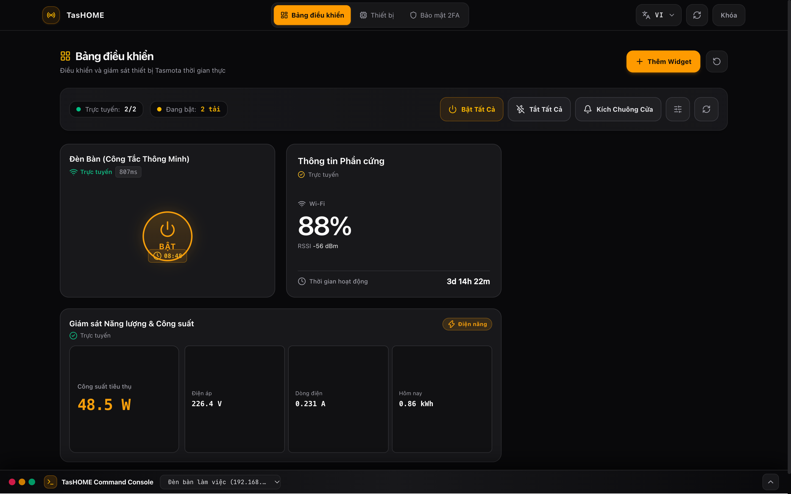
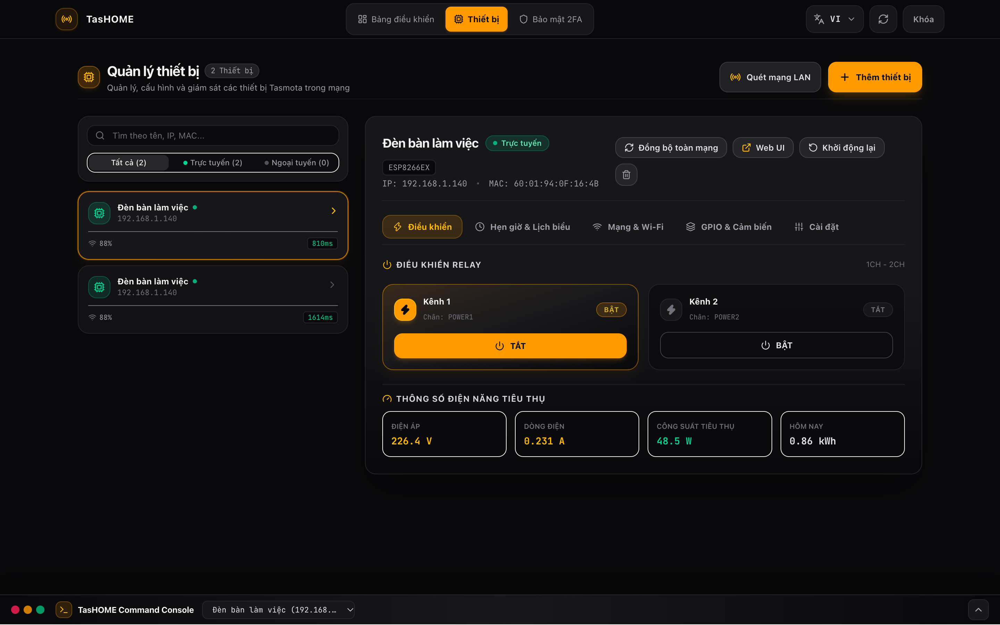

# TasHOME

> Modern, lightweight Smart Home Relay WebApp & Dashboard for Tasmota & ESP8266/ESP32 devices.

[](https://nodejs.org/)
[](https://react.dev/)
[](https://vitejs.dev/)
[](https://tailwindcss.com/)
[](LICENSE)

## Overview

**TasHOME** is a high-performance, privacy-first local smart home dashboard designed to control and monitor Tasmota-flashed microcontrollers (ESP8266 / ESP32, WMH-8266 relays, Sonoff switches, and smart power plugs).

It exists to provide a snappy, modern alternative to clunky native device web interfaces without requiring any cloud connections or third-party IoT servers. With responsive container-query grid layouts, bi-directional countdown timers, real-time energy telemetry, and automated subnet scanning, TasHOME brings desktop-grade control to your home network.

## Demo

To run a local demo:

1. Clone and install dependencies (`npm install`).
2. Start the dev server: `npm run dev`.
3. Open `http://localhost:5173/` in your browser.
4. For production mode with zero-dependency Node backend: `npm run build && npm start`.
5. Access `http://localhost:3000/` and authenticate using your RFC 6238 TOTP authenticator app.

## Screenshots

<!-- Add screenshots here -->
| Dashboard Grid & Mitosis Widget | Energy Monitoring & Telemetry |
| :---: | :---: |
|  |  |

## Features

- **Biological Mitosis Cell Division Toggle**: 2-second hover preparation with pure GPU-accelerated breathing halo, splitting into symmetrical power toggle and context-aware timer buttons with zero layout shift.
- **Context-Aware PulseTime & Delay Timers**: Automatically switches between "Turn OFF" countdown (when relay is active) and "Turn ON" delayed scheduling (when relay is inactive).
- **Responsive 9-Size Bento Grid (1×1 to 3×3)**: Fluid CSS Container Queries (`@container relay`) adapting layout density from mobile phones to ultra-wide displays.
- **Energy Monitor Widget**: Real-time tracking of Active Power (W), Voltage (V), Current (A), Apparent/Reactive Power, Power Factor ($\cos \varphi$), and daily/yesterday/total kWh.
- **Hardware & Telemetry Diagnostics**: Real-time Wi-Fi signal (RSSI/dBm), ping latency, system uptime, and live ESP GPIO pinout mapping.
- **LAN Auto-Discovery**: Fast `/24` subnet scanner probing 254 IPs concurrently with 300ms timeout to detect and import Tasmota nodes in one click.
- **1-Tap Quick Action Presets & Scenes**: Broadcast bulk commands (e.g., "All On", "All Off", "Doorbell Pulse") across all active devices via non-blocking `Promise.allSettled`.
- **Integrated Command Console**: Embedded Tasmota CLI with autocompletion, real-time response parsing, and log filtering.
- **Enterprise-Grade Security**: RFC 6238 TOTP two-factor authentication, brute-force rate limiting, and 24-hour HMAC-SHA256 signed `HttpOnly` session cookies.

## Tech Stack

### Frontend
- **Framework**: React 19 (TypeScript)
- **State Management**: Zustand 5
- **Styling**: Tailwind CSS v4 (`@tailwindcss/vite`), CSS Container Queries
- **Icons**: Lucide React
- **Build Tool**: Vite 8

### Backend
- **Runtime**: Node.js >= 18.0.0
- **HTTP Server**: Native `node:http` (zero external npm runtime dependencies)
- **Security & Crypto**: Native `node:crypto` (RFC 6238 TOTP implementation & HMAC-SHA256)

### Database
- **Storage Engine**: Atomic file-backed JSON (`data/devices.json`, `data/dashboards.json`, `data/scenes.json`, `data/settings.json`)

### Infrastructure
- **Network Protocol**: HTTP REST / Tasmota CMND JSON API
- **Deployment**: Systemd service, Docker, Tailscale / Cloudflare Tunnel

## Architecture

```text
Browser Client (Mobile / Desktop)
  │
  ▼
Frontend SPA (React 19 + Tailwind v4 + Container Queries)
  │
  ├── [Direct Local Polling (Optional)] ────────┐
  │                                             │
  ▼                                             ▼
TasHOME Backend Server (Node.js native http)    Tasmota ESP8266 / ESP32
  │                                             │ (Relays, Plugs, Sensors)
  ├── Auth & Session (RFC 6238 TOTP / HMAC)     ▲
  ├── Atomic JSON Data Store (data/*.json)      │
  ├── Subnet Scanner & Proxy Engine ────────────┘
  └── Background ASTRA Poll Scheduler (3s / 30s)
```

## Requirements

- **Runtime**: Node.js `>= 18.0.0`
- **Package Manager**: npm `>= 9.0.0`
- **Target Hardware**: ESP8266 or ESP32 flashed with Tasmota firmware (v9.0+) on the local network

## Installation

### 1. Clone repository

```bash
git clone https://github.com/Tiendepchai/TasHOME.git
cd TasHOME
```

### 2. Install dependencies

```bash
npm install
```

### 3. Configure environment

```bash
cp .env.example .env
```

### 4. Start application

```bash
npm run build
npm start
```

The application will be accessible at `http://localhost:3000`.

## Configuration

| Variable | Required | Default | Description |
|---|---|---|---|
| `PORT` | No | `3000` | Web server listening port |
| `RELAY_HOST` | No | `192.168.1.140` | Default primary Tasmota device IP address |
| `RELAY_PORT` | No | `80` | Default Tasmota HTTP port |
| `SESSION_SECRET` | Production | Development-only fallback | Private signing key of at least 32 characters; production rejects the known fallback |
| `TASHOME_STATE_DIR` | No | Current directory | Persistent `data/` and `.totp_secret` location |
| `NODE_ENV` | Production | Unset | Set to `production` to enforce provisioned credentials |

## Usage

1. Start server with `npm start`. A fresh development installation creates a private `.totp_secret` file; production requires an existing provisioned key.
2. For a new local installation only, register that key privately in Google Authenticator or 1Password. Never share it, commit it, or put it in logs. Existing installations keep their registered authenticator unchanged.
3. Open `http://localhost:3000`, enter the 6-digit code, and start managing relays. Startup logs never print credentials.

## Project Structure

```text
TasHOME/
├── data/                      # Atomic JSON data files (devices, dashboards, scenes, settings)
├── dist/                      # Production SPA bundle generated by Vite
├── src/
│   ├── core/                  # Core modules (auth, http client, i18n, config)
│   │   ├── auth/              # RFC 6238 TOTP generator, rate limiting, session manager
│   │   ├── config/            # Application constants and defaults
│   │   ├── http/              # Tasmota HTTP client & ASTRA poll scheduler
│   │   └── i18n/              # Multi-language translations (vi, en, de)
│   ├── features/              # Feature modules
│   │   ├── auth/              # 2FA verification & settings pages
│   │   ├── dashboard/         # Dashboard layout grid, add-widget modal, quick actions
│   │   ├── devices/           # Device manager, subnet discovery, timer schedule tabs
│   │   └── widgets/           # Modular widgets (relay-toggle, energy-monitor, device-info, sensor)
│   └── shared/                # Shared UI components, hooks, and parsers
├── .env.example               # Template environment configuration
├── package.json               # Dependencies and scripts
├── server.js                  # Production Node.js backend server
├── tsconfig.json              # TypeScript compilation configuration
├── vite.config.ts             # Vite build & proxy configuration
└── README.md                  # Project documentation
```

## API / Integration

TasHOME provides secure, authenticated REST endpoints under `/api`:

| Method | Endpoint | Description |
|---|---|---|
| `POST` | `/api/auth/login` | Authenticate with 6-digit TOTP code; sets `smarthome_session` cookie |
| `POST` | `/api/auth/logout` | Revoke session cookie |
| `GET` | `/api/auth/2fa` | Get current TOTP secret, QR code URI, and cycle remaining seconds |
| `GET` | `/api/devices` | List all managed Tasmota devices and relay labels |
| `POST` | `/api/devices` | Add new device or batch import discovered devices |
| `DELETE` | `/api/devices/:id` | Remove device from registry and cascade cleanup from widgets |
| `GET` | `/api/devices/discover` | Scan local `/24` subnet for Tasmota nodes (`?subnet=192.168.1`) |
| `GET` | `/api/dashboards` | Retrieve widget positions, spans (col/row), and dashboard layout |
| `POST` | `/api/dashboards` | Save updated dashboard layout |
| `GET` | `/api/scenes` | Get all saved 1-tap quick action scenes |
| `POST` | `/api/scenes/:id/execute` | Execute scene commands concurrently across target devices |
| `POST` | `/api/tasmota/cm` | Execute raw Tasmota command (`{"command": "Power1 ON"}`) |
| `ALL` | `/device-proxy/:ip/*` | Authenticated reverse proxy forwarding requests directly to Tasmota device |

## Development

```bash
# Start frontend Vite development server with HMR
npm run dev

# Build production bundle
npm run build

# Preview production build locally
npm run preview
```

## Testing

```bash
npm ci
npm run check
npm run build
node scripts/binary.self-check.mjs
python3 -I deploy/rollback.self-check.py
```

**Do not run root `npm test` or `node test.js` against a working installation.** The legacy suite can rotate `.totp_secret`. Backend smoke checks use temporary directories, fixture credentials, and loopback-only requests; real state and devices are never used.

## Deployment

### Standalone Linux ARM64 binary

Bun **1.4.4** packages the backend and built SPA into one executable. Node/npm/Bun are not required on the server; the update helper uses Python 3's standard library and systemd.

```bash
npm ci
npm run check
npm run build
npm run build:binary
# Run on Linux ARM64, not on a different architecture:
node scripts/binary.self-check.mjs artifacts/bun-linux-arm64/tashome-linux-arm64
```

Output: `tashome-linux-arm64`, `manifest.json`, `SHA256SUMS` under `artifacts/bun-linux-arm64/`. Credentials, `.env`, `data/`, source files, and node_modules are not packaged. SHA256 checksums detect corruption; they are not an independent publisher signature. GitHub repository/release permissions remain the trust boundary.

### CI and approved releases

- `ci.yml`: GitHub-hosted ARM64 runner, pinned Node/Bun/actions, typecheck, UI checks, isolated Node/binary smoke, deployment rollback checks.
- `release.yml`: run from `main`, or push a tag `binary-<full-40-character-commit-SHA>` on the reviewed delivery commit. No merge is automatic.
- Configure GitHub Environment **production** with a required maintainer reviewer and allowed refs `main` / tag `binary-*`. Approve the publishing job in GitHub Actions after CI passes.
- Only the tested artifact is uploaded; the release stays draft until every asset exists. Publishing marks it latest stable.
- The server timer checks the fixed public repository's latest stable release about every five minutes. Unchanged healthy versions are skipped. No GitHub SSH key or self-hosted runner is required.

### Existing systemd installation

The deployment helpers target `smarthome.service`, port `3000`, and existing state in `/opt/smarthome`. Inspect and back up the actual unit, drop-ins, state, and credentials **on the server** before first conversion. Do not copy local state or `.totp_secret*` to production.

| Path | Ownership / purpose |
|---|---|
| `/opt/tashome/releases/<sha>/tashome` | Root-owned immutable executable |
| `/opt/tashome/current` | Atomic active-release symlink |
| `/opt/smarthome/data/` and `.totp_secret` | Existing service-user-owned persistent state; unchanged |
| `/etc/tashome/runtime.env` | Root-owned `0600` runtime environment |
| `/usr/local/lib/tashome/` | Root-owned installer/updater helpers |

Runtime environment must provide `NODE_ENV=production`, `TASHOME_STATE_DIR=/opt/smarthome`, and a private `SESSION_SECRET` of at least 32 characters. Preserve existing `PORT`, `RELAY_HOST`, and other runtime settings. Production refuses to regenerate a missing TOTP identity. Replacing an insecure session-signing default invalidates existing sessions, **not** the authenticator key.

After reviewing the helpers and provisioning the environment/backups, install from a trusted staging directory:

```bash
sudo install -d -o root -g root -m 0755 /usr/local/lib/tashome /opt/tashome
sudo install -o root -g root -m 0755 scripts/deploy.sh scripts/update.sh /usr/local/lib/tashome/
sudo install -o root -g root -m 0644 deploy/release.py deploy/smarthome.conf /usr/local/lib/tashome/
sudo install -o root -g root -m 0644 deploy/tashome-update.service deploy/tashome-update.timer /etc/systemd/system/
sudo /usr/local/lib/tashome/deploy.sh /absolute/path/to/verified-artifacts
# Enable automatic updates only after the first deployment succeeds:
sudo systemctl daemon-reload
sudo systemctl enable --now tashome-update.timer
curl --fail http://127.0.0.1:3000/healthz
```

Deployment validates architecture, manifest/checksums, and runtime prerequisites before switching. It restarts the existing service, checks health SHA and SPA assets, and restores the previous symlink/drop-in on failure. First-install recovery returns to the original Node service. State is never rolled back automatically; there are no schema changes or automatic release deletions.

For operator-controlled rollback, disable the timer, run `deploy.sh` with a previously verified artifact directory, then verify `/healthz` and SPA. Keep original source/Node and restricted backups until the migration is accepted. Process-kill/power-loss recovery may require operator intervention.

SSH provisioning uses `/usr/bin/ssh -o BatchMode=yes` with normal host-key verification. Do not disable host verification or open SSH solely for CI. No device command is used for deployment health checks.

## Roadmap

- [x] Responsive 9-size container query grid layout (1×1 to 3×3)
- [x] Biological mitosis cell division power toggle with 2s hover halo
- [x] Context-aware bi-directional timers (Auto-Off / Auto-On via Tasmota PulseTime & Delay)
- [x] Real-time Energy Monitoring widget (W, V, A, kWh, Power Factor)
- [x] Automated `/24` subnet auto-discovery scanner
- [x] RFC 6238 TOTP 2FA authentication and rate-limiting protection
- [x] 1-Tap quick action scenes with parallel non-blocking execution
- [ ] MQTT broker integration for instantaneous push telemetry
- [ ] Historical energy logging with exportable CSV / chart analytics
- [ ] Native HomeKit / Matter bridge support

## Contributing

Contributions are welcome. Please open an issue to discuss proposed changes or submit pull requests with clear descriptions and test proof.

## Security

Do not report security vulnerabilities through public issues. For sensitive vulnerabilities, please contact the maintainer directly via GitHub security advisories.

## License

Distributed under the [MIT](LICENSE) License.

## Maintainers

- Tien Nguyen — [@Tiendepchai](https://github.com/Tiendepchai)

## Acknowledgements

- [Tasmota](https://tasmota.github.io/docs/) — Open-source firmware for ESP devices.
- [Lucide](https://lucide.dev/) — Clean, consistent icons.
- [Tailwind CSS](https://tailwindcss.com/) — Utility-first CSS framework.
- [Vite](https://vitejs.dev/) — Next generation frontend tooling.
